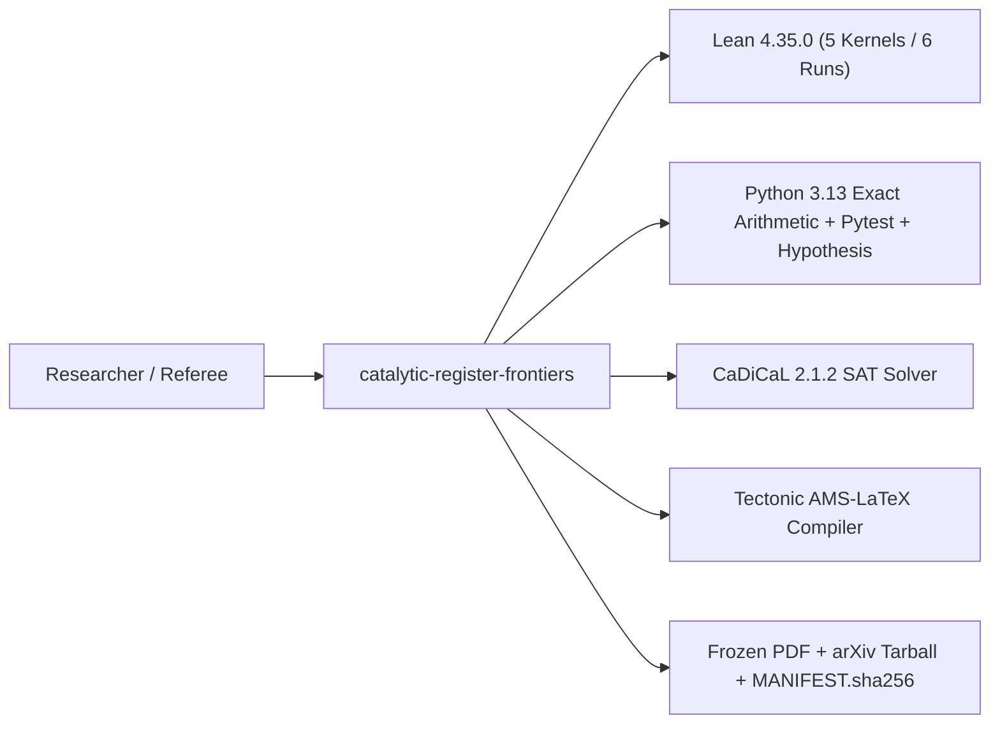
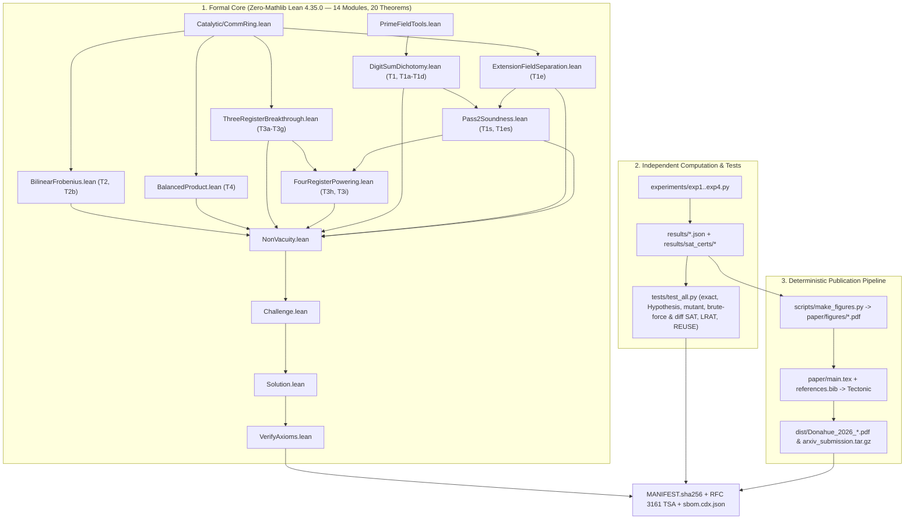

<!-- SPDX-License-Identifier: CC-BY-4.0 -->
# Architecture (`docs/architecture.md`)

`catalytic-register-frontiers` is a self-contained, zero-Mathlib mathematical verification and scientific publishing repository. Every theorem in the white paper (`paper/main.tex`) traces to machine-checked Lean 4.35.0 proofs, independent exact-arithmetic / SAT scripts, deterministic vector figures, and a SHA-256 provenance manifest.

## C4 Level 1 — System Context

## C4 Level 2 — Container & Dataflow Architecture

## Trust Boundaries & Verification Depth

- **Minimal formal trust base:** `lean/lakefile.toml` declares `dependencies = []` (no Mathlib, no Batteries). Every `.lean` file uses the Lean 4.35 `module` header and passes strict core linters (`autoImplicit = false`, `linter.unusedVariables = true`, `linter.deprecated = true`).
- **Multi-kernel independence:** `Solution.lean` is exported to LF NDJSON via `leanexport` and replayed across 6 kernel runs spanning 5 distinct implementations (`lean`, `leanchecker`, `leanchecker-paranoid`, `con-leche --verified`, `con-ron --verified`, `nanoda_bin`).
- **Exact computation boundary:** `exp1`–`exp4` use Python exact integers (`int`), exact rationals (`fractions.Fraction`), exact modular arithmetic, and CaDiCaL 2.1.2. IEEE-754 floats are used **only** for human-readable exponent display and Matplotlib axis coordinates, never for theorem certification.

## Scaling & Observability

- **Build scaling:** All 19 default Lean build jobs across 14 core modules (8,151 lines) + `PalomarSolution` compile cleanly from scratch in under 60 s on standard consumer hardware with < 2 GB RAM (zero Mathlib cache required).
- **Observability:** Every verification stage produces plain-text or JSON evidence artifacts (`results/lean_axioms.txt`, `results/six_kernel_audit.txt`, `results/exp*.json`, `docs/run-log.md`, `MANIFEST.sha256`). Health check: `just reproduce` or `pwsh -NoProfile -File scripts/run_all.ps1 -Task all`.
